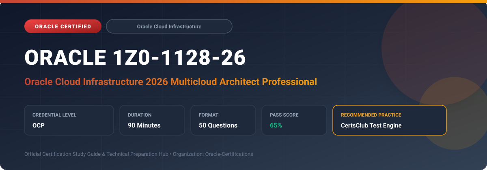

  

# Oracle 1Z0-1128-26: Oracle Cloud Infrastructure 2026 Multicloud Architect Professional

---

## 1. Exam Overview & Candidate Profile

The **Oracle 1Z0-1128-26: Oracle Cloud Infrastructure 2026 Multicloud Architect Professional** certification confirms enterprise architects skilled in designing and delivering unified multicloud solutions across OCI, Microsoft Azure, AWS, and Google Cloud.

Candidates validate deep knowledge of Oracle Database@Azure, Oracle Database@AWS, OCI-Azure Interconnect, Cross-Cloud Network topologies, unified IAM identity federation, multicloud observability, and zero-latency cross-cloud architectures.

### Target Audience & Prerequisites
- **Target Roles**: Implementation Specialists, Cloud Architects, Technical Leads, Enterprise Consultants, and Systems Engineers.
- **Recommended Experience**: 1–2 years of practical, hands-on experience designing, implementing, and maintaining corresponding Oracle solutions.
- **Credential Earned**: OCP Certification.

---

## 2. Key Exam Specifications

| Specification | Details |
| :--- | :--- |
| **Exam Code** | **Oracle 1Z0-1128-26** |
| **Official Title** | Oracle Cloud Infrastructure 2026 Multicloud Architect Professional |
| **Certification Track** | Oracle Cloud Infrastructure |
| **Exam Duration** | 90 Minutes |
| **Number of Questions** | 50 Questions |
| **Passing Score** | 65% |
| **Question Format** | Multiple Choice (Single/Multiple Answer), Scenario-Based Questions |
| **Delivery Provider** | Oracle University / Pearson VUE (Online Proctored or Test Center) |
| **Recommended Practice Engine** | [CertsClub Oracle Practice Tests](https://www.certsclub.com/oracle/1z0-1128-26-dumps.html) |

---

## 3. Official Blueprint & Exam Domain Breakdown

The examination assesses candidate competencies across core functional domains weighted as follows:

| Domain Area | Weighting |
| :--- | :--- |
| **Multicloud Strategy & Oracle Database@Azure/AWS Architecture** | `30%` |
| **High-Speed Interconnects & Cross-Cloud Networking** | `25%` |
| **Cross-Cloud Identity, IAM Federation & Governance** | `20%` |
| **Multicloud High Availability, Resilience & DR** | `15%` |
| **Observability, Cost Management & Security Posture** | `10%` |

---

## 4. Deep Dive into Complex & Challenging Technical Topics

To secure a passing score on the 1Z0-1128-26 exam, candidates must master the following advanced concepts:

- Architecting Oracle Database@Azure: physical colocation of Exadata Cloud Infrastructure inside Microsoft Azure data centers.
- Deploying Oracle Database@AWS: dedicated OCI hardware co-located inside AWS Availability Zones.
- Designing private low-latency interconnects: OCI-Azure Interconnect with private IP routing and zero egress fees.
- Configuring cross-cloud federated identity with Microsoft Entra ID (Azure AD), AWS IAM Identity Center, and OCI Identity Domains.
- Cross-cloud Disaster Recovery patterns using Oracle Data Guard with automated failover across cloud providers.

---

## 5. Scenario-Based Demo & Practice Questions

### Question 1
What architectural deployment model does Oracle Database@Azure utilize to achieve sub-millisecond network latency between Azure application services and Oracle Exadata Database Service?

A) Colocating OCI-managed Exadata hardware directly inside Microsoft Azure physical data centers
B) Establishing a public VPN tunnel over the public internet
C) Storing database backups on USB drives shipped across sites
D) Emulating Oracle Database on standard Azure Virtual Machines

- **Correct Answer**: `A) Colocating OCI-managed Exadata hardware directly inside Microsoft Azure physical data centers`  
- **Technical Explanation**: Oracle Database@Azure places genuine OCI hardware and Exadata Database Service clusters physically inside Azure regions, connected directly to Azure Virtual Networks with sub-millisecond latency.

---

### Question 2
When connecting an OCI VCN to an Azure VNet via the OCI-Azure Interconnect, which networking components establish the private BGP peering connection without crossing the public internet?

A) OCI Dynamic Routing Gateway (DRG) via FastConnect and Azure ExpressRoute Gateway
B) Internet Gateway and Azure NAT Gateway
C) Public IPsec VPN over public IPs
D) Local Peering Gateway and Azure Load Balancer

- **Correct Answer**: `A) OCI Dynamic Routing Gateway (DRG) via FastConnect and Azure ExpressRoute Gateway`  
- **Technical Explanation**: The OCI-Azure Interconnect links an OCI FastConnect virtual circuit directly to a Microsoft Azure ExpressRoute circuit, managed through an OCI DRG and an Azure ExpressRoute Gateway.

---

## 6. Recommended Preparation Strategy & Practice Testing Engine

Achieving certification in **Oracle 1Z0-1128-26** requires balanced theoretical study and scenario-based simulation practice:

1. **Review Oracle Documentation**: Master architecture guides, implementation workbooks, and administration manuals on the Oracle Help Center.
2. **Hands-on Lab Practice**: Execute real-world configuration, policy setup, and troubleshooting tasks in your cloud tenancy or test instance.
3. **Simulated Exam Drills**: Practice answering timed, scenario-based multiple-choice questions to familiarize yourself with the question formats, traps, and timing constraints.

### Practice With CertsClub
For realistic practice questions, updated dumps, and mock testing environments:
- **Resource**: [CertsClub Oracle Practice Test Engine](https://www.certsclub.com/oracle/1z0-1128-26-dumps.html)
- **Special Discount**: Use coupon code **`club20`** during checkout for an instant **20% discount** on all practice exam bundles and testing engines.

---

## 7. Official Documentation & References

- [Oracle University Certification Registry](https://education.oracle.com/)
- [Oracle Help Center Documentation Portal](https://docs.oracle.com/)
- [Oracle Cloud Infrastructure & Applications Guides](https://docs.oracle.com/en/cloud/)
- [CertsClub Oracle Certification Exam Practice](https://www.certsclub.com/oracle/1z0-1128-26-dumps.html)

---

## 8. SEO & Discovery Keywords

`oracle 1z0-1128-26, oracle 1z0-1128-26 exam, oracle 1z0-1128-26 dumps, 1Z0-1128-26 practice questions, 1Z0-1128-26 study guide, oracle cloud infrastructure 2026 multicloud architect professional, certsclub 1z0-1128-26`